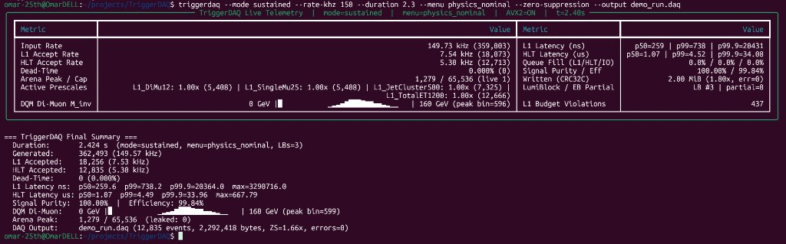
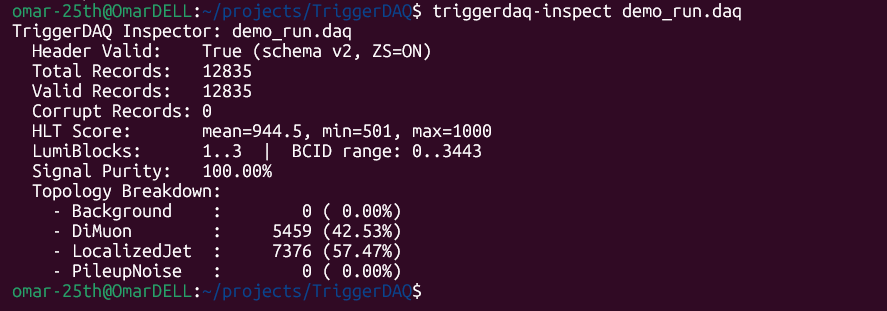
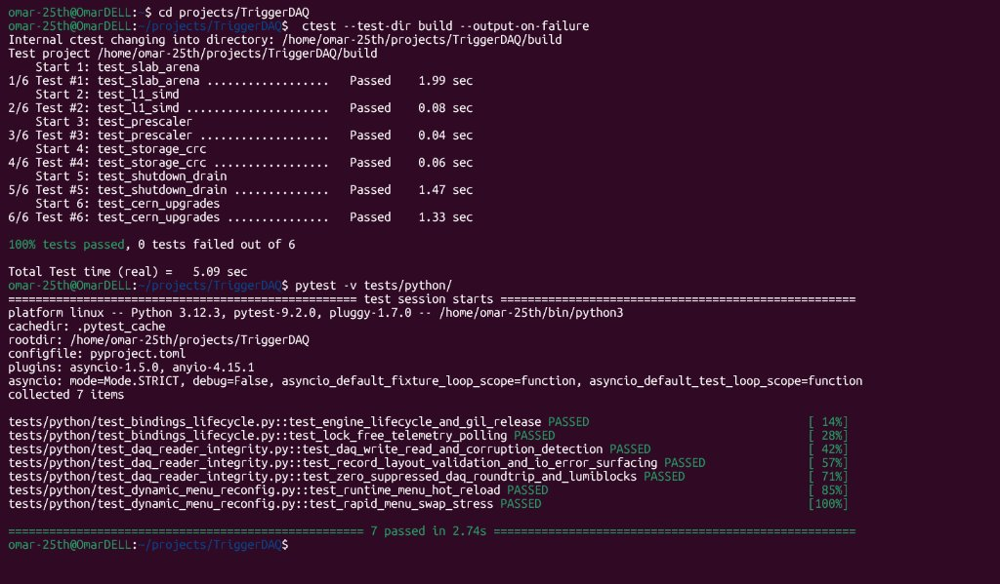

# TriggerDAQ

**Hybrid C++20 / Python Two-Stage Real-Time Detector Trigger & Data Acquisition (DAQ) Engine**

📖 **Live Documentation:** https://triggerdaq.vercel.app

Modeled on CERN's ATLAS/CMS Level-1 (L1) and High-Level Trigger (HLT) architecture, TriggerDAQ separates **lock-free, zero-allocation C++20 hot-path execution** from a **Python 3.12+ control, telemetry, and analysis plane** connected via `nanobind`.

---

## Architecture & Dataflow

```text
+=======================================================================================+
|                       PYTHON 3.12+ CONTROL & TELEMETRY PLANE                          |
|  [Run Control FSM & Menu]  [Live Rich/ANSI + DQM Bar Chart]  [DaqReader / NumPy View] |
|    configure/start/pause         ^  snapshot() (<1 us)          ^  zero-copy CRC32C   |
|    update_menu() (seqlock)       |  LumiBlock ledger            |  raw & ZS decode    |
+=========|========================|==============================|=====================+
          |          nanobind (_triggerdaq_ext, GIL released)     |
+=========v========================|==============================|=====================+
|                        C++20 ZERO-ALLOCATION HOT-PATH CORE      |                     |
|                                                                 |                     |
|  +-----------------------+   Calo/Muon ROBs  +------------------+----+                |
|  |   Detector Emulator   | ----------------> |  Event Builder (opt)  |                |
|  |  xoshiro256** + LHC   |   (or direct L1)  |  Matches Calo & Muon  |                |
|  |  Orbit/BCID Filling   |                   |  by event_id + timeout|                |
|  |  (3564 BCID, abort gap)                   |  -> PARTIAL_EB flag   |                |
|  +-----------+-----------+                   +----------+------------+                |
|              | acquire()                                | SlotHandle (BoundedChan)    |
|              v                                          v                             |
|  +-----------------------+                   +-----------------------+                |
|  |      SlabArena        |                   |    L1 SIMD Trigger    |                |
|  |  64B-aligned 256B pool| <---------------- | AVX2 / Scalar Kernels |                |
|  |  128-bit CAS freelist |    release()      | + Closed-Loop PI      |                |
|  |  (64-bit tag, ABA-safe)    on reject      |   Prescaler (EMA+75%) |                |
|  +-----------^-----------+                   +----------+------------+                |
|              |                                          | SlotHandle (lossless drain) |
|              |                                          v                             |
|              |                               +-----------------------+                |
|              |                               |   HLT Worker Farm     |                |
|              |                               | W std::jthreads       |                |
|              |                               | Recon + Int8 MLP +    |                |
|              |                               | Live DQM Histograms   |                |
|              |                               +----------+------------+                |
|              | release()                                | SlotHandle (lossless drain) |
|              | post-CRC32C                              v                             |
|              +------------------------------ +-----------------------+                |
|                                              |  Async EventWriter    | --- .daq v2 -->|
|                                              | Double-Buffered 256KB | (raw or ZS     |
|                                              | SSE4.2 CRC32C + EINTR |  1.66x codec)  |
|                                              +-----------------------+                |
+=======================================================================================+
```

### Engineering & CERN-Domain Guarantees
- **Zero Hot-Path Allocations:** After `TriggerEngine::configure()`, no thread on the Frontend → Event Builder → L1 → HLT → Storage path allocates heap memory. Events travel solely as 32-bit `SlotHandle` descriptors backed by a 64-byte-aligned `SlabArena` with inline 128-bit double-word CAS (`-mcx16`, 64-bit monotonic tag).
- **Race-Free, Sanitizer-Verified Concurrency:** Verified **100% clean** under both **AddressSanitizer/UBSan** and **ThreadSanitizer (TSan)**. `AtomicMenuSlot` uses atomic-word seqlock transfers returning `TriggerMenu` by value; `AtomicLatencyHistogram` uses seqlock snapshots with within-bucket linear interpolation; `BoundedChannel` uses unsigned wraparound-safe arithmetic, atomic `size_`, and explicit 4-stage lossless EOS draining.
- **LHC Orbit/BCID Timing & Run Control FSM:** Configurable LHC 25 ns bunch-train filling scheme (`3564` BCIDs/orbit, abort gap `[3444, 3563]`), validated `RunState` FSM (`Initial → Configured → Running ⇄ Paused → Stopped → Initial`), and periodic Luminosity Block (`LumiBlockRecord`) accounting ledger exported in JSON reports.
- **Live DQM Physics Histograms:** Per-worker atomic 32-bin Di-Muon invariant mass (`0–160 GeV`), 16-bin Jet $E_T$, and 64-cell calorimeter occupancy maps merged into `TelemetrySnapshot` and rendered as a live Unicode bar chart in the CLI dashboard.
- **Zero-Suppression (ZS) Storage Codec (Schema v2):** Optional pedestal zero-suppression (`--zero-suppression`) stores only above-threshold `(cell_idx, energy)` pairs with hardware SSE4.2 CRC32C framing (`1.66x` compression), transparently decompressed by `verify_daq_file()` / `DaqReader` into import-time C++-validated `RECORD_DTYPE` NumPy arrays.
- **Sub-Detector Event Builder (`--enable-eb`):** Splits Frontend output into independent Calorimeter and Muon ROB streams matched by `event_id` in a pre-allocated assembly table, flagging timed-out partial events (`FRAME_STATUS_PARTIAL_EB`) with zero `SlabArena` slot leaks.

---

## Live CLI & Test Run Screenshots

### Live Rich Telemetry Dashboard (`triggerdaq --mode sustained --rate-khz 150 --zero-suppression`)


### Binary `.daq` CRC32C & Zero-Suppression Inspector (`triggerdaq-inspect`)


### C++20 `ctest` (6/6) & Python `pytest` (7/7) Test Suite Run


---

## Building & Testing

### 1. C++20 Core, Unit Tests & Benchmark (`cmake` + `ctest`)
```bash
cmake -B build -G Ninja -DCMAKE_BUILD_TYPE=Release
cmake --build build -j
ctest --test-dir build --output-on-failure -V
./build/bench_pipeline
```

### 2. Sanitizer CI Matrix (ASan/UBSan & TSan)
```bash
# AddressSanitizer + UndefinedBehaviorSanitizer
cmake -B build_asan -G Ninja -DCMAKE_BUILD_TYPE=RelWithDebInfo \
  -DCMAKE_CXX_FLAGS="-fsanitize=address,undefined -fno-omit-frame-pointer" \
  -DCMAKE_EXE_LINKER_FLAGS="-fsanitize=address,undefined"
cmake --build build_asan -j && ctest --test-dir build_asan --output-on-failure

# ThreadSanitizer
cmake -B build_tsan -G Ninja -DCMAKE_BUILD_TYPE=RelWithDebInfo \
  -DCMAKE_CXX_FLAGS="-fsanitize=thread -fno-omit-frame-pointer" \
  -DCMAKE_EXE_LINKER_FLAGS="-fsanitize=thread"
cmake --build build_tsan -j && setarch x86_64 -R ctest --test-dir build_tsan --output-on-failure
```

### 3. Python Control Plane & CLI
```bash
pip install -e .
pytest -v tests/python/

# Run 5s stress test with Zero-Suppression storage & JSON LumiBlock report
triggerdaq --mode stress --duration 5 --zero-suppression --output run_zs.daq --report-json report.json

# Verify CRC32C checksums, decompress ZS records, and inspect topology purity
triggerdaq-inspect run_zs.daq
```

---

## Benchmark Results

Measured on Ubuntu 24.04 (WSL2, `g++ 13.3.0`, `-std=c++20 -O3 -mavx2 -msse4.2 -mcx16`, 4 HLT workers, 65,536 `SlabArena` slots, `physics_nominal` menu):

### Pure C++20 Pipeline (`./build/bench_pipeline`)
| Mode | Input Rate | L1 / HLT Accept | Dead-Time | L1 Latency (p50 / p99) | HLT Latency (p50 / p99) | Purity / Eff | ZS Ratio | LumiBlocks | EB Timeout Rate | Leaked |
| :--- | ---: | ---: | ---: | :---: | :---: | :---: | ---: | ---: | ---: | ---: |
| **Sustained (200 kHz)** | 198.58 kHz | 9.91 / 6.91 kHz | 0.00% | 285 ns / 741 ns | 1.12 µs / 4.45 µs | 100.00% / 99.84% | 1.00x (OFF) | 2 | N/A | 0 |
| **PoissonBurst (250 kHz, ZS)** | 247.30 kHz | 12.47 / 8.70 kHz | 0.00% | 262 ns / 605 ns | 0.99 µs / 2.77 µs | 100.00% / 99.86% | **1.66x** | 2 | N/A | 0 |
| **MaxThroughputStress (ZS)** | **1,214.43 kHz** | 60.84 / 42.56 kHz | 0.00% | **277 ns / 696 ns** | **0.94 µs / 2.18 µs** | **100.00% / 99.86%** | **1.66x** | 3 | N/A | 0 |
| **EventBuilder (200 kHz, 1% drop)** | 180.37 kHz | 9.08 / 6.31 kHz | 0.00% | 268 ns / 692 ns | 1.06 µs / 3.60 µs | 100.00% / 99.44% | **1.66x** | 2 | **1.03%** | 0 |

### End-to-End Python CLI Stress Run with Zero-Suppressed Disk Storage (`triggerdaq --mode stress --duration 5 --zero-suppression`)
- **Generated:** `5,312,240` frames (`1,052.25 kHz`, `6` LumiBlocks)
- **L1 Accepted:** `262,028` (`51.90 kHz`, `p50=266.0 ns`, `p99=781.7 ns`)
- **HLT Accepted & Written:** `183,687` (`36.38 kHz`, `32.80 MB` CRC32C-framed ZS `.daq`, **`1.66x`** compression, `0` write errors)
- **DQM Di-Muon Invariant Mass (`0–160 GeV`):** `0 GeV |█           ▁▂▃▅▆▇██▇▇▆▅▄▃▂▁▁   | 160 GeV`
- **Integrity (`triggerdaq-inspect`):** `183,687 / 183,687` valid records (`0` corrupt, schema v2 ZS=ON, `LumiBlocks 1..6`, `BCID 0..3443`, `100.00%` signal purity: `78,677` DiMuon + `105,010` LocalizedJet, `0` Background, `0` PileupNoise).

---

## Verification Summary
- **C++ Release (`ctest`):** **6/6 passing** (`test_slab_arena`, `test_l1_simd`, `test_prescaler`, `test_storage_crc`, `test_shutdown_drain`, `test_cern_upgrades`).
- **ASan + UBSan (`ctest`):** **6/6 passing** (0 memory errors, 0 leaks, 0 undefined behavior).
- **ThreadSanitizer (`ctest`):** **6/6 passing** (0 data races across 10M-cycle `SlabArena` stress, lossless backpressure drain, and Event Builder fault injection).
- **Python (`pytest`):** **7/7 passing** (lifecycle/GIL release, FSM transitions, DQM histogram peak, 500x rapid menu swap stress, raw & ZS `.daq` integrity, layout offset validation, and I/O error surfacing).
